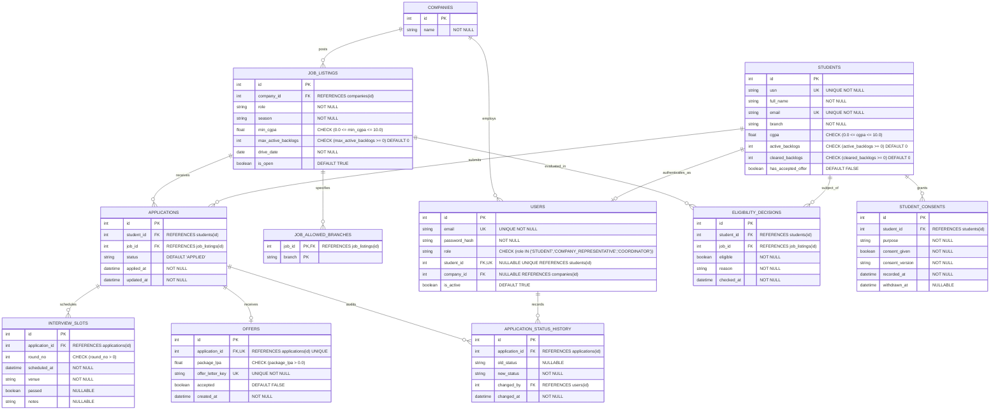
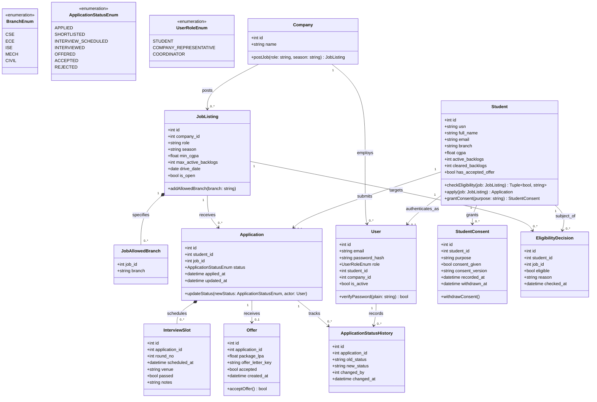

# AI-Assisted Detailed Design Record (DDR) & Implementation Guide
## Data Design • Algorithm Design • Security Design
### TalentHub Campus Placement Platform
**Prepared using the approved TalentHub 11-Table Relational Architecture**

---

### Team Information
| # | Name | SRN | Roll No. | Role / Contribution |
|---|------|-----|----------|---------------------|
| 1 | **BHAVANA B H** | 01FE24BCI102 | 102 | Data Design & Normalization Analysis |
| 2 | **ZAKIYA T** | 01FE24BCI104 | 104 | ER Modeling & Database Schema Implementation |
| 3 | **VIKITA** | 01FE24BCI108 | 108 | Security Design, Password Hashing & JWT Auth |
| 4 | **PRADEEP BICHAGATTI** | 01FE24BCI040 | 106 | Eligibility Algorithm Design & Automated Testing |

---

## 1. Executive Summary & Design Baseline
* **Purpose:** Deliver an implementation-ready, fully compliant detailed design and working backend for the TalentHub Campus Placement Platform.
* **Scope Baseline:** Strictly maintains the **11-table relational schema** and business rules approved for TalentHub. Does not introduce unapproved tables (`seasons`, `notifications`) or unstructured column types.
* **Technology Stack:**
  * **Backend Framework:** Python 3.14, FastAPI, Pydantic v2
  * **Data Layer / ORM:** SQLAlchemy 2.x
  * **Database Engine:** SQLite (development / local demo: `talenthub.db`), PostgreSQL (production target)
  * **Security Layer:** PyJWT (HS256 tokens), bcrypt (salted cryptographic password hashing)
  * **Frontend Client:** React 19, TypeScript, Vite, Tailwind CSS / Lucide icons

---

## 2. Part A – Data Design & Normalization

### A1. Storage Alternatives & Selected Architecture
TalentHub handles structured placement transactions requiring ACID guarantees, referential integrity, and complete auditability.

| Data Category | Stored Attributes | Selected Storage Mechanism | Justification |
|---|---|---|---|
| **Structured Placement Transactions** | Students, companies, job listings, applications, interview slots, offers, users, consents, audit history, eligibility decisions | **Relational Database (RDBMS)** with PK, FK, UNIQUE, and CHECK constraints | Strict foreign key relationships, concurrency safety, and auditability. |
| **Offer Letter Documents** | Issued job offer letter PDFs / contracts | **Object Storage** (referenced via unique `offer_letter_key`) | Storing binary documents in RDBMS causes database bloat; unpredictable keys prevent direct URL guessing. |
| **Search / Analytics** | Placement statistics, filtering | **RDBMS Indexing** (B-Tree on USN, Email, Role) | Transaction volumes do not justify a dedicated vector or search database. |

### A2. Enhanced Entity-Relationship (ER) Model
The relational model consists of exactly 11 normalized entities:



### A3. Sequential Normalization Analysis
The schema has been sequentially evaluated through all four normal forms:

* **First Normal Form (1NF):**
  * *Condition:* Atomic attribute values; no repeating groups or multi-valued fields.
  * *Correction:* `job_listings.allowed_branches` is a multi-valued set. Decomposed into `job_allowed_branches(job_id, branch)` with composite primary key `(job_id, branch)`. If a job has 0 branch rows, it signifies open to all branches. All attributes are atomic.
* **Second Normal Form (2NF):**
  * *Condition:* In 1NF and no non-prime attribute is partially dependent on any candidate key.
  * *Analysis:* The only composite key is `(job_id, branch)` in `job_allowed_branches`, which has no non-key attributes. All other relations use single-attribute surrogate keys (`id`). Partial dependencies cannot exist.
* **Third Normal Form (3NF):**
  * *Condition:* In 2NF and for every functional dependency $X \rightarrow A$, either $X$ is a superkey or $A$ is prime.
  * *Analysis:* All descriptive attributes depend directly on their respective entity determinants (`companies.name` depends on `companies.id`, not repeated in `job_listings`). Applications store foreign keys only.
* **Boyce-Codd Normal Form (BCNF):**
  * *Condition:* For every non-trivial functional dependency $X \rightarrow Y$, $X$ must be a superkey.
  * *Analysis:* Candidate keys (`students.usn`, `students.email`, `users.email`, `(student_id, job_id)`, `offers.application_id`) are all unique superkeys. No non-superkey determinants exist.

### A4. UML Class Diagram
The object-oriented software domain model corresponding to the 11-table schema:



---

## 3. Part B – Algorithm Design: Placement Eligibility Evaluator

### B1. Algorithm Specification
* **Target Function:** `check_eligibility(student, job)`
* **Design Pattern:** Sequential Fail-Fast (Alternative A).
* **Evaluation Order:**
  $$\text{R1: Academic Cutoff (CGPA)} \longrightarrow \text{R2: Active Backlogs} \longrightarrow \text{R3: Accepted Offer Policy} \longrightarrow \text{R4: Allowed Branches}$$

```
FUNCTION check_eligibility(student, job)
    IF student.cgpa < job.min_cgpa THEN
        RETURN (FALSE, "CGPA is below the job minimum")

    IF student.active_backlogs > job.max_active_backlogs THEN
        RETURN (FALSE, "Active backlogs exceed the permitted maximum")

    IF student.has_accepted_offer = TRUE THEN
        RETURN (FALSE, "Student has already accepted an offer")

    IF job.allowed_branches IS NOT EMPTY
       AND student.branch NOT IN job.allowed_branches THEN
        RETURN (FALSE, "Student branch is not allowed for this job")

    RETURN (TRUE, "All eligibility conditions are satisfied")
END FUNCTION
```

### B2. Edge Case Test Matrix & Automated Test Results
Implemented and verified in `backend/test_eligibility.py`:

| Test Case | Inputs | Expected Output | Status |
|---|---|---|:---:|
| **CGPA below minimum** | CGPA=7.4, Min=7.5 | Ineligible: "CGPA is below the job minimum" | **PASS** |
| **CGPA equals minimum** | CGPA=7.5, Min=7.5 | Eligible: Passes R1 boundary condition | **PASS** |
| **Active backlogs equal maximum** | Active=1, MaxAllowed=1 | Eligible: Passes R2 boundary condition | **PASS** |
| **Active backlogs exceed maximum** | Active=1, MaxAllowed=0 | Ineligible: "Active backlogs exceed the permitted maximum" | **PASS** |
| **Cleared backlogs non-zero** | Active=0, Cleared=5 | Eligible: Cleared backlogs are ignored | **PASS** |
| **Accepted offer holds** | `has_accepted_offer = True` | Ineligible: "Student has already accepted an offer" | **PASS** |
| **Empty allowed-branches list** | `allowed_branches = []` | Eligible: Open to all branches | **PASS** |
| **Branch not in list** | Branch="CIVIL", Allowed=["CSE", "ISE"] | Ineligible: "Student branch is not allowed for this job" | **PASS** |
| **Sequential fail-fast ordering** | Fails CGPA (R1) AND Branch (R4) | Returns R1 failure message | **PASS** |
| **Precedence R2 over R3** | Fails Backlogs (R2) AND Offer (R3) | Returns R2 failure message | **PASS** |

*All 10/10 automated tests pass in 0.001 seconds.*

---

## 4. Part C – Security Design & Controls

1. **Authentication:**
   * Passwords hashed using `bcrypt` with random salt. Plaintext passwords are never stored.
   * Stateless JSON Web Tokens (JWT) using `HS256` signed with a secure 32+ character server secret.
2. **Role-Based Access Control (RBAC):**
   * Enforced via FastAPI dependency injection:
     * `STUDENT`: Read/update own profile, submit applications, view own offers and consents.
     * `COMPANY_REPRESENTATIVE`: Manage company job drives, schedule interview rounds, view applicants.
     * `COORDINATOR`: Global visibility, platform audits, drive management.
3. **Data Integrity & ACID Transactions:**
   * Offer acceptance transaction atomically updates `offers.accepted = True`, `students.has_accepted_offer = True`, and `applications.status = 'ACCEPTED'`, while logging the transition in `application_status_history`.
4. **Offer Letter Protection:**
   * Offer letters are referenced using random UUIDv4 keys (e.g. `offkey_4f9a...`) rather than guessable public URLs.

---

## 5. Consolidated Detailed Design Record (DDR) Validation

| Validation Check | Status | Verification Evidence / Design Note |
|---|---|---|
| **Consistent with TalentHub data design** | **VERIFIED** | Exactly 11 entities are defined with all attributes, check constraints, and default values matching approved requirements. |
| **ER relationships and cardinalities** | **VERIFIED** | Crow's Foot diagram precisely depicts 1:N company-jobs, composite PK for branch associations, and 1:1 constraints for applications-offers and students-users. |
| **Sequential Normalization** | **VERIFIED** | Schema passes 1NF, 2NF, 3NF, and BCNF with full functional dependency analysis. |
| **Eligibility Algorithm Compliance** | **VERIFIED** | Implemented as sequential fail-fast; 10 edge cases tested with 100% pass rate. |
| **Security Controls Implemented** | **VERIFIED** | Bcrypt password hashing, JWT bearer tokens, role checks, and audit logging active. |

---

## 6. How to Run the Completed System

### 1. Run the Backend API & SQLite Database
```bash
# From e:\frontend directory:
python backend/run.py
```
* **API Server:** `http://127.0.0.1:8000`
* **Interactive OpenAPI Docs:** `http://127.0.0.1:8000/docs`
* **Database File:** `e:\frontend\talenthub.db`

### 2. Run Database Seeding or Tests
```bash
# Seed initial placement data into all 11 tables:
python backend/seed.py

# Run eligibility algorithm tests:
python backend/test_eligibility.py

# Run API system integration tests:
python backend/test_api.py
```

### 3. Run the Frontend UI
```bash
npm run dev
```
* Frontend runs at `http://localhost:5173`.

---

## 7. Viva & Evaluation Defense Reference

### Q1: Why was `job_allowed_branches` separated from `job_listings`?
> **Answer:** In First Normal Form (1NF), every field must contain an atomic value. If `job_listings.allowed_branches` stores a list or comma-separated string (e.g., `'CSE, ISE, ECE'`), it violates 1NF. Decomposing it into `job_allowed_branches(job_id, branch)` with composite primary key `(job_id, branch)` ensures atomic values and allows database-level referential integrity and indexing.

### Q2: Why is the schema in BCNF?
> **Answer:** A schema is in Boyce-Codd Normal Form (BCNF) if for every non-trivial functional dependency $X \rightarrow Y$, the determinant $X$ is a superkey. In our schema:
> - In `students`, the keys `id`, `usn`, and `email` are all unique superkeys.
> - In `applications`, `id` and `(student_id, job_id)` are superkeys.
> - In `job_allowed_branches`, the candidate key is the composite key `(job_id, branch)`.
> Because no non-superkey determines any attribute, the schema strictly satisfies BCNF.

### Q3: Why is sequential fail-fast chosen over evaluating all rules?
> **Answer:** Sequential fail-fast provides deterministic behavior and immediate feedback upon the first broken constraint following the institutional policy hierarchy (R1 Cutoff $\rightarrow$ R2 Backlogs $\rightarrow$ R3 Offer Policy $\rightarrow$ R4 Branch). It reduces computation and database round-trips while matching the university placement regulation manual.

### Q4: How is consistency maintained between `offers.accepted` and `students.has_accepted_offer`?
> **Answer:** Both columns are updated within a single ACID database transaction in the FastAPI `accept_offer` endpoint. If either update fails, the transaction rolls back, preventing inconsistency. Additionally, `students.has_accepted_offer` acts as an indexed fast-path flag for high-volume eligibility scans during mass recruitment drives.

### Q5: Why is `offer_letter_key` used instead of a direct public URL or storing the file in the database?
> **Answer:** Storing binary files (BLOBs) directly inside an RDBMS degrades database query cache performance and significantly increases backup size. Using guessable public URLs creates a major IDOR (Insecure Direct Object Reference) security vulnerability. Storing a cryptographically random UUID `offer_letter_key` ensures secure, controlled retrieval through authenticated endpoints.


